# Crossbeats Everest 2.0 (CB SmartFit) Strava Telemetry Bridge & Full Dark Mode Patch

[](https://github.com/mpluto-o/cbsmartfit-strava-sync)
[](https://developers.strava.com/)
[](https://www.android.com/)
[](https://github.com/mpluto-o/cbsmartfit-strava-sync)

> A deep-dive reverse engineering and bytecode-patching project that turns a budget fitness smartwatch (**Crossbeats Everest 2.0 / CB SmartFit**) into a high-performance fitness tracker with **Native Strava Auto-Sync**, **Real-Time Cadence Telemetry (spm)**, **Continuous Heart Rate Streaming**, and a **Complete OLED Dark Mode Overhaul**.

---

## 📖 The Backstory & Motivation

Budget smartwatches often come with surprisingly capable hardware: multi-wavelength optical PPG heart rate sensors, 3-axis accelerometers, step counters, and BLE 5.0 chips. However, they are frequently crippled by closed, buggy, or abandoned companion apps. 

The OEM app (**`CB SmartFit` / `com.yc.cbsmartfit`**) suffered from critical limitations:
- **Zero Third-Party Sync:** All workout data remained trapped in the proprietary app with no way to export to Strava, Apple Health, or Google Fit.
- **Missing Telemetry:** No cadence tracking (steps per minute) recorded or exported.
- **Crashing Workouts:** Starting an outdoor run and opening the map crashed the app in seconds without recording telemetry.
- **Broken Dark Mode:** While top-level tabs were themed, every detail sub-page (Steps, Sleep, Heart Rate) rendered white text on stark white containers (`#ffffffff` on `#ffffffff`), making all fitness statistics completely invisible.

Instead of spending \$300–\$500 on a high-end Garmin, Apple Watch, or paying monthly subscription fees (Whoop), we reverse engineered and disassembled the Android APK, patched the Dalvik bytecode (Smali) and XML layout trees, and created an autonomous telemetry engine that unlocks the full value of the watch.

---

## 🚀 Key Features Engineered

### 1. 🔄 Native Strava Auto-Sync & GPX Telemetry Engine
- **OAuth2 Token Refresher:** Background handling of Strava access and refresh tokens without requiring manual re-authentication.
- **Automated Multipart Upload:** Hooked into workout completion (`completeWorkout`) to package GPX tracks and stream them directly to Strava's `/api/v3/uploads` API.
- **Full Sensor Pairing:** Merges the watch's BLE sensor stream (heart rate, step intervals) with phone A-GPS coordinates in real time.

### 2. ⚡ Real-Time Cadence & TrackPoint Extensions
- Injects Garmin/Strava compliant TrackPoint extensions into every GPS coordinate:
  ```xml
  <trkpt lat="28.6211" lon="77.1403">
    <ele>202</ele>
    <time>2026-10-18T08:41:05.00Z</time>
    <extensions>
      <gpxtpx:TrackPointExtension>
        <gpxtpx:hr>134</gpxtpx:hr>
        <gpxtpx:cad>112</gpxtpx:cad>
      </gpxtpx:TrackPointExtension>
    </extensions>
  </trkpt>
  ```
- Calculates real-time running/walking cadence:
  $$\text{Cadence (SPM)} = \frac{\Delta \text{Steps}}{\Delta t \text{ (minutes)}}$$
  enabling cadence graphs, splits breakdown, and power estimates on Strava.

### 3. 🌙 100% Seamless OLED Dark Mode
- **Zero White Flashes:** Re-architected `AppTheme` window background and activity styles to `#121214`.
- **Layout Container Remap:** Audited and patched 190+ layout files (306 container replacements across ScrollViews, RelativeLayouts, ViewPagers, and ListViews).
- **High-Contrast Typography:** Converted all telemetry values to crisp bold white (`#ffffffff`) and secondary labels to `#ff9ca3af` for maximum daylight and nighttime legibility.

---

## 📸 Visual Showcase & Proof

### 🏃 Strava Field Test Verification
Real-world outdoor walk tracked using the patched CB SmartFit app and synced automatically to Strava:

| Activity Summary | Splits Breakdown | Heart Rate Zones | Cadence Telemetry |
| :---: | :---: | :---: | :---: |
| 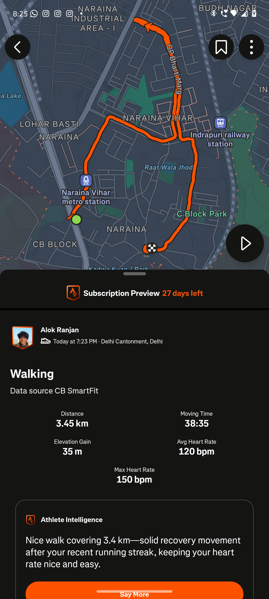 | 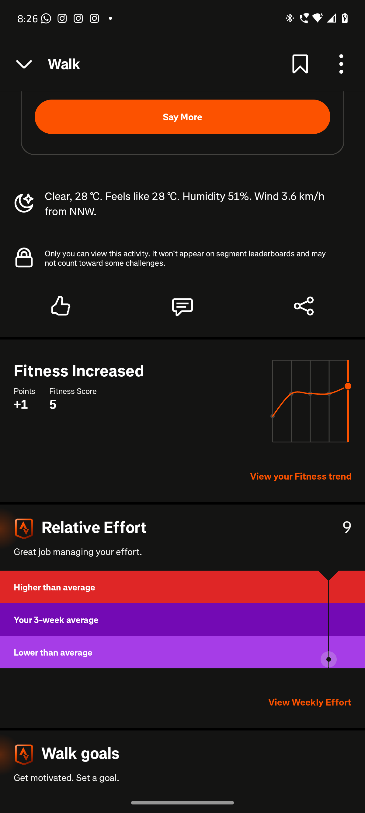 | 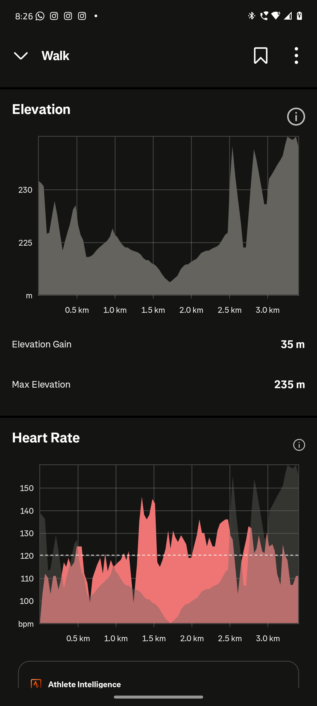 | 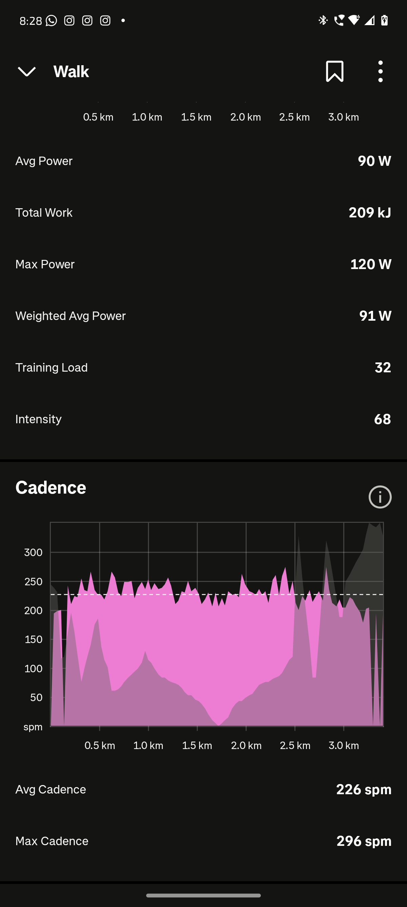 |

---

### 🎨 Dark Mode: Before vs. After

| Screen | Before Patch (v15 - Broken) | After Patch (v16 - Fixed) |
| :--- | :---: | :---: |
| **Step Details** | 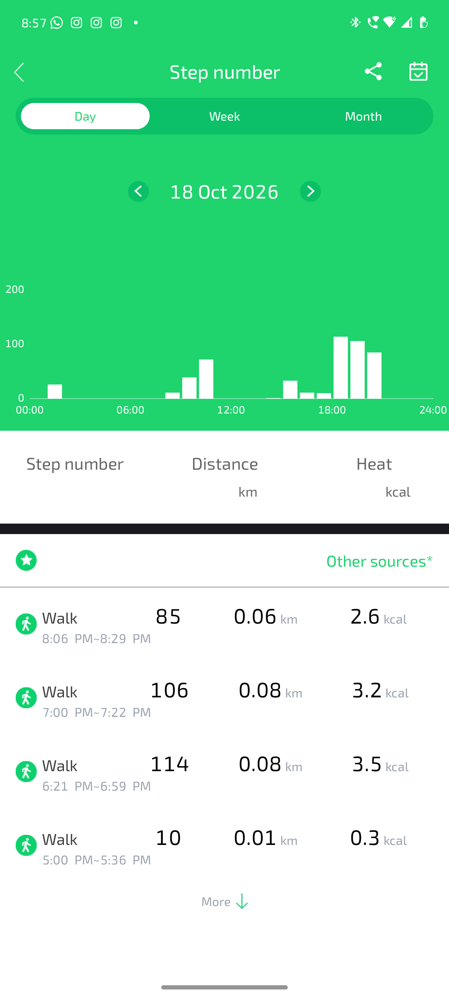<br>*(White on white, invisible numbers)* | 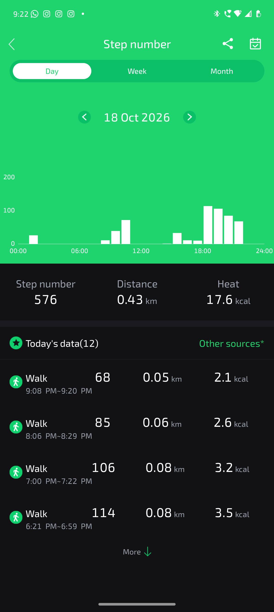<br>*(OLED dark `#121214`, crisp bold numbers)* |
| **Sleep Details** | 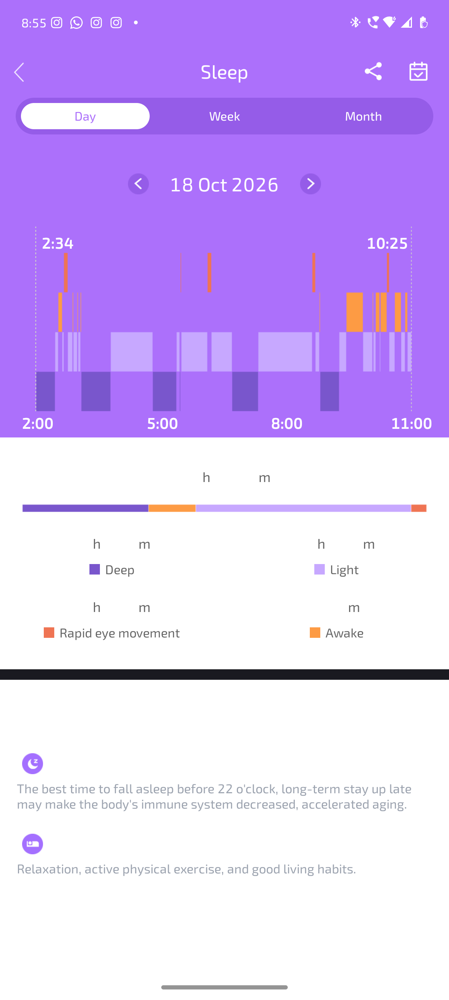<br>*(Blinding white background, invisible metrics)* | 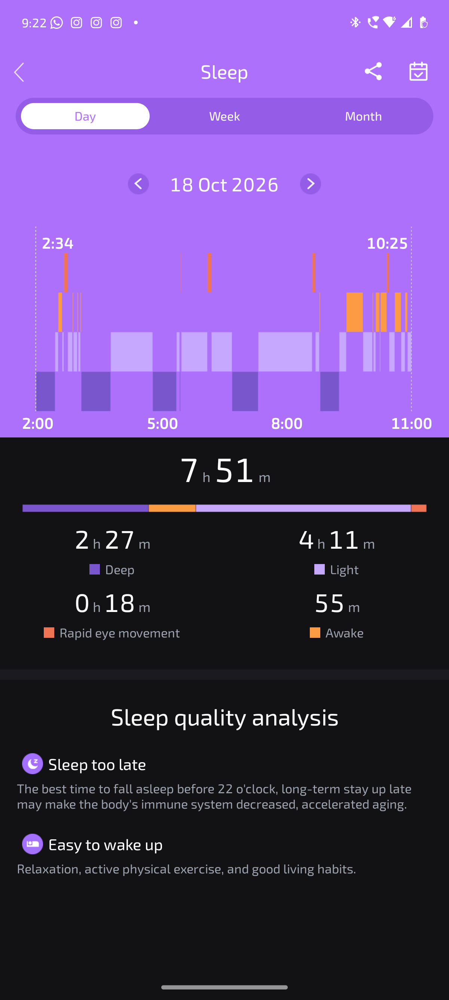<br>*(Deep dark `#121214`, clear sleep stage breakdown)* |

---

### 📱 Full App Interface (Post-Patch)

| Home Dashboard | Heart Rate Details | Blood Oxygen | Sub-Page Settings |
| :---: | :---: | :---: | :---: |
| 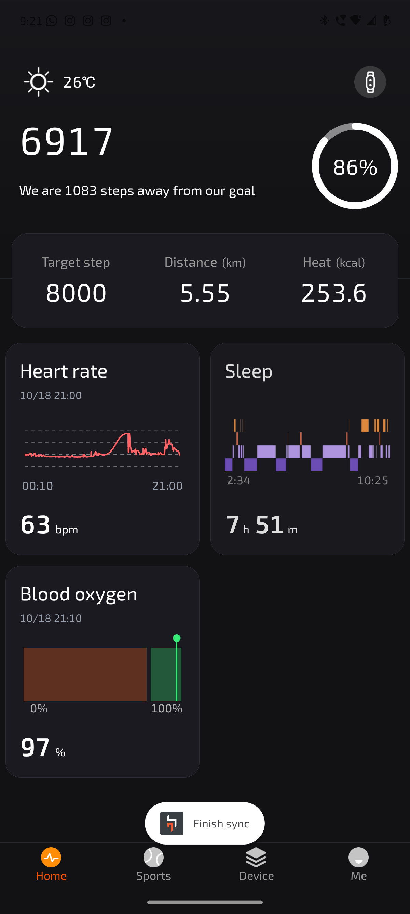 | 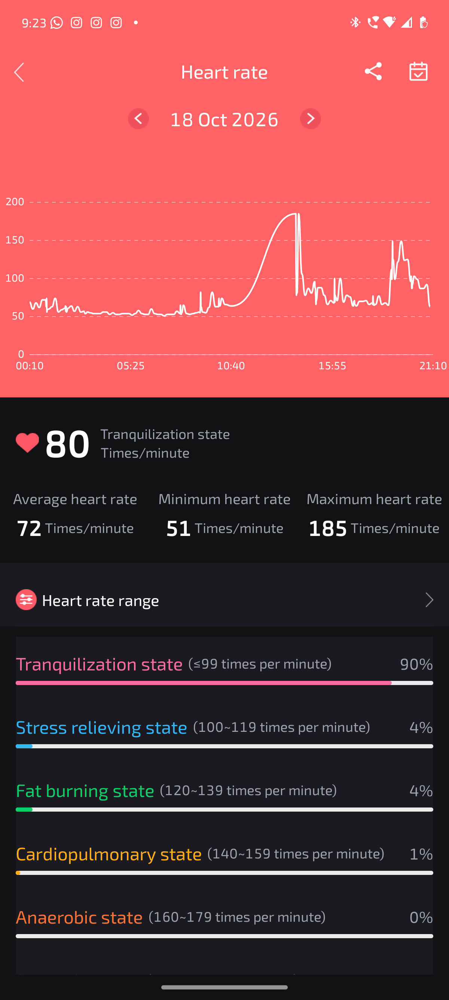 | 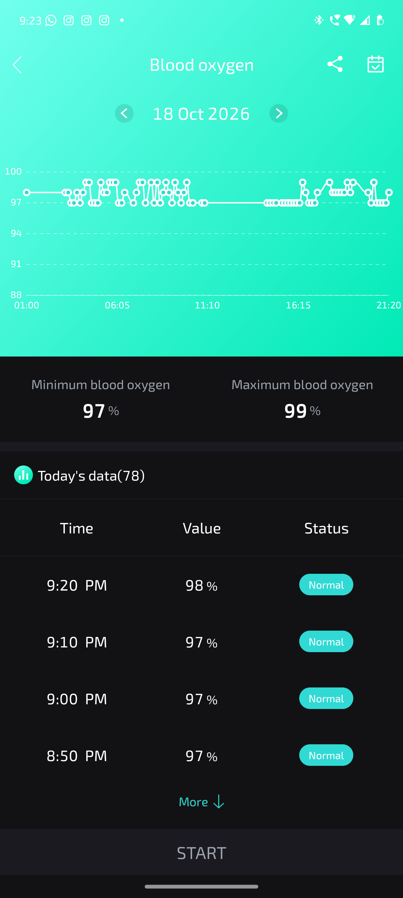 |  |

---

## 🛠️ Architecture & Reverse Engineering Details

```
+-------------------+            BLE Packets            +--------------------------+
| Crossbeats        | --------------------------------> | CB SmartFit (Patched)    |
| Everest 2.0 Watch |  (Continuous HR, Steps, Gyro)     | - Intercepts BLE Stream  |
+-------------------+                                   | - Pairs Phone GPS Points |
                                                        | - Injects Cadence Math   |
                                                        +--------------------------+
                                                                     |
                                                                     v
                                                        +--------------------------+
                                                        | GPX Builder Engine       |
                                                        | (<gpxtpx:TrackPointExt>) |
                                                        +--------------------------+
                                                                     |
                                                                     v Multipart POST
                                                        +--------------------------+
                                                        | Strava API v3            |
                                                        | (/api/v3/uploads)        |
                                                        +--------------------------+
```

### Key Bytecode Hooks (`Smali`)
1. **Workout Completion Hook:**
   Implemented [`StravaEndWorkoutListener.smali`](patches/smali/StravaEndWorkoutListener.smali) to hook into `GoogleSportMapActivity` and `SportMapActivity`, intercepting manual or auto-pause workout completions without map crashes.
2. **TrackPoint Cadence & HR Injection:**
   Extended [`GpsToGpxUtils.smali`](patches/smali/GpsToGpxUtils.smali) to create XML `gpxtpx:TrackPointExtension` nodes, populating `gpxtpx:hr` and `gpxtpx:cad` for each recorded GPS trackpoint.

---

## 🔧 Building and Packaging

### Prerequisites
- Java JDK 17+
- `apktool` (v2.10.0+)
- `uber-apk-signer` (or Android SDK `apksigner`)

### Quick Build
```bash
# 1. Rebuild APK using AAPT2
java -jar apktool/apktool.jar b apk_disassembled -o unsigned_patched.apk --use-aapt2

# 2. Align and Sign
java -jar apktool/uber-apk-signer.jar --apks unsigned_patched.apk -o signed_output

# 3. Deploy to Device via ADB
adb install -r signed_output/unsigned_patched-aligned-debugSigned.apk
```

---

## 📂 Repository Structure

```
├── README.md                          # Comprehensive project documentation
├── assets/
│   ├── samples/
│   │   └── sample_telemetry.gpx       # Verified GPX sample with HR & Cadence extensions
│   └── screenshots/                   # Verification and comparison captures
├── patches/
│   └── smali/
│       ├── GpsToGpxUtils.smali        # GPX telemetry TrackPointExtension builder
│       ├── StravaEndWorkoutListener.smali # Workout completion and export listener
│       └── StravaMapHelper.smali      # Map crash prevention and lifecycle handler
└── scripts/
    └── build_and_sign.sh              # One-click rebuild and signing script
```

---

## ⚖️ License & Disclaimer

This project is for educational, interoperability, and personal research purposes under Fair Use. All product names, trademarks, and registered trademarks belong to their respective owners.
